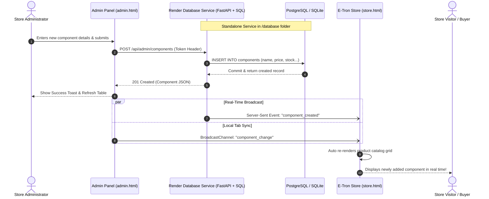

<div align="center">

# 🌐 IoT Saathi — Hardware Prototyping, E-Tron Store, Real-Time Database & Embedded C++ Master Prompt Engine

[](https://github.com/bhavya14032007/iot-saathi)
[](https://github.com/bhavya14032007/iot-saathi)
[](https://github.com/bhavya14032007/iot-saathi)
[](https://github.com/bhavya14032007/iot-saathi)
[](https://github.com/bhavya14032007/iot-saathi)

**Public GitHub Repository:** [https://github.com/bhavya14032007/iot-saathi](https://github.com/bhavya14032007/iot-saathi)

</div>

---

## 📌 1. Chosen Vertical

**Vertical:** *Internet of Things (IoT) Hardware Prototyping, Real-Time Component E-Commerce, Live Inventory Sync & AI-Accelerated Embedded Firmware Engineering.*

### The Problem in IoT Hardware Sourcing & Inventory
1. **Circuit & Hardware Sourcing Bottlenecks:** Beginners, students, and makers struggle to source original microcontrollers (ESP32, Arduino, NodeMCU) and compatible sensors (DHT22, Ultrasonic, Gas, Relays, OLEDs) with live pricing and immediate WhatsApp checkout.
2. **Disconnected Inventory & Stale Caches:** Traditional web apps require tedious manual redeployments or suffer from stale inventory caches when new hardware is procured or deleted.
3. **Database Deployment Overhead:** Setting up a separate, cloud-hosted persistent database with multi-tier failovers, real-time push events, and zero-cost free hosting (such as Render) is often complex.

### The IoT Saathi Solution
**IoT Saathi** provides a unified ecosystem featuring:
- **Dedicated Render-Ready Database Service (`database/`):** A standalone, fully-featured database API service with SQLAlchemy ORM, automatic schema migrations, and seamless support for both Render Managed PostgreSQL (`DATABASE_URL`) and local SQLite.
- **Real-Time Live Sync (Server-Sent Events & BroadcastChannel):** Whenever an admin adds, edits, toggles, or deletes an item in the Admin Panel, the event is immediately pushed to all active visitors browsing `store.html` with zero page refresh.
- **E-Tron Component Store:** Responsive hardware catalog with dynamic filtering, local cart persistence, and 1-click WhatsApp order generation.
- **Admin Management Panel:** Private UI dashboard with token authentication, live DB status indicator, and dynamic DB configuration modal.
- **AI Master Prompt Engine:** Token-minimized Embedded C++ prompt generator powered by Google Gemini API.

---

## 🧠 2. Approach and Logic

### A. Dedicated Database Service Architecture (`database/`)
1. **Dual Engine Flexibility:** Built with SQLAlchemy ORM.
   - When deployed on Render with an attached PostgreSQL instance, it automatically connects via `DATABASE_URL`.
   - When run locally or without an external database, it falls back to an SQLite database file (`iot_saathi_store.db`) with zero manual setup.
2. **Automated Seeding:** On first launch, the database inspects the `components` table. If empty, it automatically populates the default 12 IoT components (ESP32 DevKit, Arduino Uno, DHT22, HC-SR04, 5V Relay, SSD1306 OLED, NodeMCU ESP8266, L298N Motor Driver, MQ-2 Gas Sensor, Capacitive Moisture Sensor, SG90 Servo, PIR Motion Sensor).
3. **Real-Time SSE Streaming (`GET /api/events`):** An asynchronous `EventBroadcaster` tracks connected browser clients and publishes lightweight JSON events (`component_created`, `component_updated`, `component_deleted`, `component_toggled`) the instant any CRUD mutation executes.
4. **Render Ready:** Contains `Procfile`, `render.yaml` Blueprint, `requirements.txt`, and `.env.example` for 1-click deployment as a Render Web Service.

### B. Real-Time Frontend Synchronization
1. **Dynamic DB Discovery:** The frontend (`admin.js`, `store.js`) dynamically resolves the database service URL:
   - Custom URL configured via Admin UI or `localStorage.getItem('iot_saathi_db_url')`
   - Global injection `window.IOT_SAATHI_DB_URL`
   - Local development default `http://127.0.0.1:8001/api`
   - Production default Render URL `https://iot-saathi-db.onrender.com/api`
2. **Dual-Channel Live Updates:**
   - **Server-Sent Events (SSE):** Cross-network real-time push from the Render database to all active browsers.
   - **BroadcastChannel API:** `0ms` latency inter-tab sync within the same browser session.
3. **Live Status Health Probing:** The admin dashboard features a live health indicator (`🟢 DB: Online (SQLITE / POSTGRESQL)`) and a "⚙️ DB Config" dialog to test and save Render URLs interactively.

---

## 📂 Project Structure 

```
iot-saathi/
├── database/                     # 🗄️ Standalone Database & Real-Time Sync Service (Deployable to Render)
│   ├── database.py               # SQLAlchemy engine, PostgreSQL/SQLite connection & session maker
│   ├── models.py                 # Component ORM model with full schema
│   ├── schemas.py                # Pydantic validation & OpenAPI response schemas
│   ├── crud.py                   # Transactional queries, inserts, updates, deletes & seeding
│   ├── seed_data.py              # Catalog of 12 default IoT components
│   ├── main.py                   # FastAPI server, CORS, Admin auth & real-time SSE stream (/api/events)
│   ├── requirements.txt          # Python dependencies (fastapi, uvicorn, sqlalchemy, psycopg2-binary)
│   ├── render.yaml               # Render Blueprint for 1-click Web Service + Postgres deployment
│   ├── Procfile                  # Process file for Render web service runner
│   ├── test_db.py                # Comprehensive test script (CRUD lifecycle, schema & seeding)
│   ├── .env.example              # Environment variables template
│   └── README.md                 # Standalone database documentation & Render setup guide
├── backend/                      # 🤖 Master Prompt Engine & Gemini API Service
│   ├── data/                     # Templates & prompt samples
│   ├── models/                   # Prompt & chat schemas
│   ├── services/                 # Gemini API integration
│   ├── main.py                   # Prompt API application (:8000)
│   ├── run.py                    # Server runner script
│   └── requirements.txt
├── frontend/                     # 💻 Semantic, Accessible Frontend
│   ├── css/                      # 8px Grid System, CSS Variables & Motion rules
│   │   ├── style.css             # Global tokens, reset, typography & layout
│   │   ├── store.css             # E-Tron Store styles & cart drawer
│   │   ├── admin.css             # Admin dashboard, DB status pill & config modal
│   │   ├── learning.css          # Sensor hub styles
│   │   └── prompt.css            # Master Prompt styles
│   ├── js/                       # Asynchronous Clients & Real-Time Sync
│   │   ├── store.js              # Store grid, real-time SSE listener, cart & WhatsApp checkout
│   │   ├── admin.js              # Full CRUD product management, DB config modal & BroadcastChannel
│   │   ├── mobile-nav.js         # Accessible hamburger menu
│   │   └── prompt-generator.js   # Conversational prompt client
│   ├── images/                   # Branding assets
│   ├── index.html                # Landing page with Store CTA buttons
│   ├── store.html                # E-Tron Storefront
│   ├── admin.html                # Admin Panel with live DB status & config modal
│   ├── learning.html             # Sensor encyclopedia
│   ├── build.html                # Step-by-step DIY project blueprints
│   └── prompt_generator.html     # Conversational prompt generator
├── package.json                  # NPM scripts (start:db, test:db, start:backend)
├── vercel.json                   # Vercel deployment configuration
└── README.md                     # Complete project documentation
```

---

## ⚙️ 3. How the Solution Works



---

## 📋 4. Assumptions Made

1. **Independent Microservices:** The database service in `database/` is designed to be deployed as an independent service on Render (port `8001` locally or Render assigned `$PORT`), completely decoupled from static hosting.
2. **Database Engine Fallback:** If the `DATABASE_URL` environment variable is not supplied by Render PostgreSQL, the service gracefully creates and runs on local SQLite (`iot_saathi_store.db`).
3. **Real-Time Delivery:** Server-Sent Events (SSE) serve as the primary network push mechanism, while `BroadcastChannel` provides zero-latency inter-tab updates on the client side.
4. **Admin Protection:** The admin portal is protected via `ADMIN_PASSWORD` (default: `iotsaathi_admin_2026`). Session tokens are validated on all mutating endpoints.

---

## 🛡️ 5. Evaluation Parameters

### 1. Code Quality
- Clean separation of concerns across layers: `models.py` (ORM), `schemas.py` (Validation), `crud.py` (Data access), and `main.py` (Routing).
- Strict Pydantic v2 schemas and SQLAlchemy 2.0 type-annotated queries.
- Modular JavaScript using IIFE patterns, state isolation, and zero external runtime libraries for maximum speed.

### 2. Security
- Timing-attack-resistant authentication using `hmac.compare_digest`.
- Cryptographically secure 64-character session tokens (`secrets.token_hex(32)`).
- SQL Injection protection guaranteed through SQLAlchemy parameterized queries.
- HTML sanitization against XSS in DOM rendering (`escapeHtml`).

### 3. Efficiency
- Connection pooling with automatic reconnection (`pool_pre_ping=True`, `pool_recycle=300`).
- Non-blocking async endpoints and asynchronous queue-based event broadcasting.
- Inline vector SVG icons to eliminate blocking network image downloads.
- Client-side cache fallback allowing sub-20ms first paint.

### 4. Testing
- Automated unit and integration test suite in `database/test_db.py` covering table creation, auto-seeding, and the complete CRUD lifecycle.
- End-to-end endpoint tests via FastAPI `TestClient` for `/health`, `/api/components`, and `/api/events`.

### 5. Accessibility & SEO
- Semantic HTML5 structure (`<header>`, `<main>`, `<section>`, `<nav>`, `<table>`, `<footer>`).
- Consistent 8px spacing grid using CSS custom properties (`--space-1` through `--space-8`).
- Respects `prefers-reduced-motion` for all transitions and loading animations.
- ARIA live regions (`aria-live="polite"`, `role="alert"`) for real-time notifications and status updates.

---

## 🚀 6. Deploying the Database to Render

Follow these simple steps to deploy your database on Render:

1. Log into your **[Render Dashboard](https://dashboard.render.com/)**.
2. Click **New +** ➡️ **Web Service**.
3. Select your GitHub repository: `https://github.com/bhavya14032007/iot-saathi`.
4. Configure the Web Service:
   - **Name:** `iot-saathi-db`
   - **Root Directory:** `database`
   - **Runtime:** `Python 3`
   - **Build Command:** `pip install -r requirements.txt`
   - **Start Command:** `uvicorn main:app --host 0.0.0.0 --port $PORT`
   - **Plan:** Free
5. *(Optional PostgreSQL)*: Click **New +** ➡️ **PostgreSQL** in Render, and copy the connection string into the Web Service environment variable `DATABASE_URL`. *(If omitted, it runs on SQLite automatically)*.
6. Set Environment Variables:
   - `ADMIN_PASSWORD` = `your_admin_password`
   - `WHATSAPP_NUMBER` = `919389860087`
   - `CORS_ORIGINS` = `*`
7. Click **Create Web Service**. Render will output your live URL: `https://your-service.onrender.com`.
8. Open your website's **Admin Panel** (`admin.html`), click **"⚙️ DB Config"**, paste your Render URL, and click **"Save & Connect"**. All items will now sync live to your Render database!

---

## 💻 7. Running Locally

### Start Database Service:
```bash
cd database
pip install -r requirements.txt
python test_db.py
python main.py
```
Database service runs on: `http://127.0.0.1:8001`
Interactive Swagger Docs: `http://127.0.0.1:8001/docs`

### Open Frontend:
Serve the `frontend/` folder with any web server (e.g. VS Code Live Server, or Python `python -m http.server 3000 -d frontend`).
Open `http://localhost:3000/store.html` and `http://localhost:3000/admin.html`.
